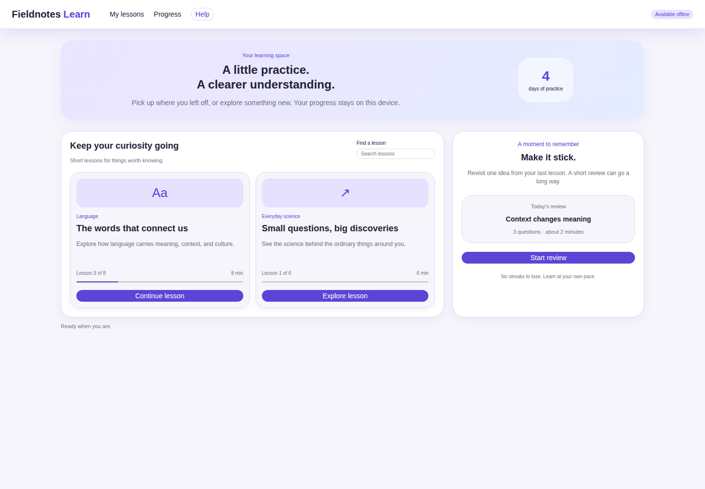
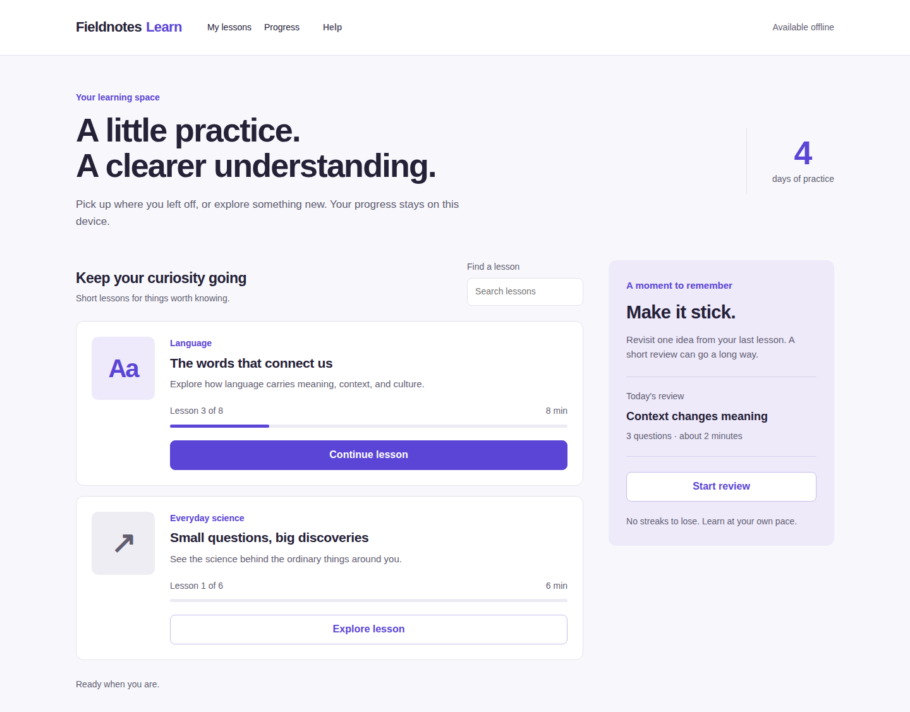

# Polish Proof

**Polish the screen. Keep the product. Show the receipt.**

A small agent skill for improving an existing web UI without silently rewriting its copy, controls, brand or logic. A portable proof layer for your preferred design skill—not another palette catalog.

## Same product. CSS-only polish.

| Before | After |
|---|---|
|  |  |

The purple brand, Arial, all copy, HTML and JavaScript stayed intact. The treatment reduces nested containers, strengthens type hierarchy and gives Continue one clear primary treatment. [Phone before](evidence/before-phone.png) → [phone after](evidence/after-phone.png) · [tablet before](evidence/before-tablet.png) → [tablet after](evidence/after-tablet.png). Click images for native size; these are unedited full-page browser captures.

**Measured, not a beauty score:**

| Check | Before → after |
|---|---|
| Horizontal overflow, 390px phone | 430px → 0px |
| Horizontal overflow, 768px tablet | 52px → 0px |
| Continue button height | 24px → 46.8px |
| Search field height | 21px → 44px |
| Declared text/control/source invariants | Preserved at all 3 viewports |
| Actual interaction runs | 4/4 pass: before + after, phone + desktop |

[Reproducible CI](https://github.com/mozzie49/polish-proof/actions/runs/39752555452) · [raw receipt](evidence/receipt.json) · [behavior results](evidence/interactions.json) · [review, iteration and tradeoffs](evidence/verification-status.md).

**Experimental, synthetic demonstration.** The baseline was deliberately authored with defects, not sampled from a real user's app. This shows an inspectable repair, not that this skill beats no-skill prompting or competing skills. No external adoption is claimed. [Demand and competition](DEMAND.md).

## Use the skill

Copy `skills/polish-proof` into your agent's supported skills directory. For a repository-local Codex-style installation:

```sh
mkdir -p /path/to/project/.agents/skills
cp -R skills/polish-proof /path/to/project/.agents/skills/
```

Then ask:

> Use polish-proof to make this learning screen feel less cluttered. Preserve our purple brand, Arial font, all copy and behavior. Check phone and desktop, and show me exactly what improved and what stayed the same.

The skill works with existing project/browser tools. The optional receipt helper needs Node + Playwright; it never installs anything, uploads data, or edits the application.

## What makes the result reviewable

- A bounded patch rather than an unsolicited rebrand or rewrite.
- Paired screenshots from the same states/viewports.
- A frozen contract for page text, control descriptors, protected source files and declared target dimensions.
- Explicit interaction tests; source hashes alone are **not** behavior proof.
- A task-based visual review with `improved / unchanged / worse / uncertain` judgments—not an invented beauty score.

**Why visual review matters:** the first proposal passed every mechanical check, but put Continue below the phone's first fold. Viewing the screenshot caught it. The final CSS brings its bottom from y888 to y809 in an 844px viewport without changing the contract or deleting content. Balanced headings also remove an awkward orphan word. The [first draft screenshot](evidence/first-draft-phone.png) remains available.

## Reproduce the demo

`demo/before` is a deliberately flawed, working educational fixture. `demo/after` is the reviewed CSS-only treatment; HTML and JavaScript are byte-identical.

```sh
npm install
npx playwright install chromium
npm test
npm run demo:verify
# Or use an existing system browser:
CHROMIUM_PATH=/usr/bin/chromium npm run demo:verify
```

Use an authorized environment that permits local preview servers and Chromium. Evidence is written under `evidence/run-*`. The capture refuses to overwrite an existing snapshot. The unit tests cover broken-preservation and missing-proof cases; they do not certify aesthetic quality.

Full instructions: [SKILL.md](skills/polish-proof/SKILL.md) · [receipt helper](skills/polish-proof/references/receipt.md) · [visual review rubric](skills/polish-proof/references/review.md).

## Optional compact report images

For long pages, set `"viewportCompanion": true` in the capture contract before taking both sides. The helper keeps `phone.png` as full-page evidence and adds `phone.viewport.png` directly from the same browser page and viewport. Receipts include image dimensions, hashes and framing. Link both; the compact view intentionally omits below-fold content. [Contract example and limits](skills/polish-proof/references/receipt.md).

`npm run demo:verify` also exercises a synthetic 375×4777px page: the original remains full height, the companion is 375×812px, filenames/hashes/frames are verified, and the paired receipt must pass. This regression fixture addresses a [reported screenshot-reporting failure](https://github.com/anthropics/claude-code/issues/104618), not a reproduction of its macOS cropping-tool behavior.

## Limits and tradeoffs

More readable text and stacked lessons increase vertical scrolling: tablet Review and part of desktop Explore move below the initial fold. This treatment prioritizes continuing a lesson; a review-first product would need a different decision. Help's visual button affordance is weaker. These are tradeoffs, not hidden wins.

The helper captures a fresh light-mode Chromium state, not all states or browsers. It does not prove full accessibility, detect every overlay/clipping case, or cover canvas/shadow-root content. It cannot decide whether an interface is beautiful. A preview permission failure remains a verification blocker, not a reason to invent a successful result.
